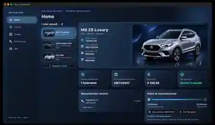

# DriveGlass — Public Showcase

> **Demo del progetto, non sorgenti dell'app commerciale.** Il software Flutter/Dart e i componenti backend rimangono privati.

**[▶ Guarda DriveGlass sul portfolio](https://giovannidelgaudio.it/driveglass-demo/)** · **[📘 Scheda tecnica del progetto](https://github.com/GiovanniDelGaudio1994/GiovanniDelGaudio1994/tree/main/projects/driveglass)**

## Video reale

[Visualizza la registrazione ottimizzata (MP4)](assets/driveglass-real-demo-2026.mp4)

Il video è un breve estratto di una registrazione dell'**8 novembre 2026** che mostra l'app Flutter su Mac durante test locali. È diverso dal mockup grafico che compare nella copertina. Non dimostra funzioni OBD, telemetria in diretta o comandi remoti.

## Prova PDF: Passaporto digitale

La [sezione Document Center della demo](https://giovannidelgaudio.it/driveglass-demo/#pdf-proof) ora include una **riproduzione visuale HTML dei campi del PDF realmente esportato dall'app il 09/11/2026**. Il documento originale fornito è un Passaporto digitale DriveGlass non ufficiale: MG ZS Luxury (2022), chilometraggio dichiarato 12.000 km, un intervento del 08/11/2026 e spesa registrata di 129,50 EUR.

**Non è una fattura né un certificato.** L'anteprima sul sito è una trascrizione, non il PDF originale; non prova manutenzione o chilometraggio verificati da terzi.

### Filmato Full HD
Il player preferisce `assets/driveglass-demo-fullhd-2026.mp4` e usa il video compresso `driveglass-real-demo-2026.mp4` come fallback finché il file HD non è stato caricato. Il video originale H.264 va aggiunto separatamente al repository e non deve essere ricompresso. Nessun codice Flutter privato viene distribuito.

## Stato dei moduli

| Modulo | Stato |
|---|---|
| Dashboard e Garage | Interfaccia implementata e testata localmente |
| Maintenance Center | Interventi, costi e chilometraggio salvati localmente |
| Persistenza SQLite | Verificata in sviluppo |
| Document Center | Esportazione PDF verificata nelle versioni precedenti |
| Galleria auto | Illustrativa, esplorazione dei modelli |
| Cloud Garage / Node.js | In sviluppo |
| Telemetria e comandi auto remoti | Non dimostrati né disponibili nella demo pubblica |

La pagina web è una ricostruzione illustrativa navigabile delle funzionalità, accompagnata dal **filmato autentico**, senza accesso al database, ai documenti o alle credenziali del proprietario.

## Separazione del codice

- `driveglass-demo/index.html`: presentazione web autonoma e non proprietaria.
- `driveglass-demo/assets/`: filmato breve e fotogramma dimostrativo.
- **Flutter, Dart, Node.js, SQLite e repository di sviluppo**: rimangono privati.

© 2026 Giovanni Del Gaudio. Il materiale pubblicato non autorizza il riutilizzo dei componenti proprietari.

### Caricamento degli originali senza perdita di qualità

Dopo il push dei file binari, il sito rende disponibili [registrazione Full HD](assets/driveglass-demo-fullhd-2026.mp4) e [Passaporto digitale PDF originale](assets/passaporto-digitale-driveglass-2026.pdf). Questi due asset devono essere pubblicati separatamente dal codice, tramite lo script di trasferimento per macOS. Il PDF non è una fattura né un certificato ufficiale e riporta solo dati inseriti dall'utente.
